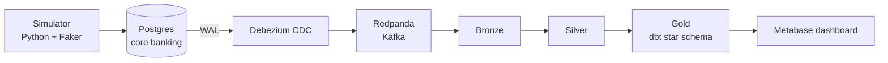

# Banking Transaction Analytics Pipeline

An end-to-end data engineering project. It captures changes from a bank database in near real time, cleans them, builds an analytics-ready star schema, checks its own numbers, and shows the results on a dashboard.

## Architecture

| Layer | What it does |
|---|---|
| Simulator | Creates bank transactions, including messy data on purpose (duplicates, late events, negative amounts, wrong currency, missing device id). |
| Postgres (`core_banking`) | The source bank database. |
| Debezium and Redpanda | Capture every change from the Postgres log and queue it as events. |
| Bronze | Raw events stored as JSON, exactly as they arrived. |
| Silver | Clean transactions. Bad rows go to a quarantine table with a reason. Customer data is masked. Customer and account history is kept. |
| Fraud rules | SQL rules: velocity, high value, structuring. |
| Gold (dbt) | Star schema: 4 dimensions and 1 fact table. `dim_customer` is SCD Type 2. |
| Reconciliation | Compares the source database with Silver and Gold (7 checks). |
| Dashboard (Metabase) | 5 charts for business and pipeline health. |

## Progress

- [x] Docker Compose setup
- [x] Postgres schema (customers, accounts, merchants, transactions, ledger_entries)
- [x] Data simulator with messy data (duplicates, late events, invalid values, updates)
- [x] CDC with Debezium and Redpanda (connector running)
- [x] Bronze layer (Python consumer)
- [x] Silver layer (dedup, validation, quarantine, PII masking)
- [x] Fraud detection rules
- [x] Gold layer with dbt (star schema, SCD Type 2, 14 tests)
- [x] Reconciliation job (core vs warehouse, 7 checks)
- [x] Dashboard (Metabase: 5 charts, pipeline health and business)
- [x] Failure drills (4 drills, see `docs/failure-drills.md`)
- [x] Design decisions (see `docs/decisions/decisions.md`)

## Results

| Check | Result |
|---|---|
| Source bank transactions | 1632 |
| Silver clean + quarantine | 1569 + 63 = 1632 |
| Gold `fact_transactions` | 1569 rows, equal to Silver |
| Amounts | Source total = Silver + quarantine, to the paisa |
| dbt tests | 14 of 14 pass (unique, not_null, relationships, custom SCD test) |
| Reconciliation | 7 of 7 checks pass |
| `dim_customer` | 117 versions for 100 customers (SCD Type 2) |

Quarantine reasons: DUPLICATE, INVALID_CURRENCY, MISSING_DEVICE_ID, NON_POSITIVE_AMOUNT.

## Failure drills

I broke the pipeline on purpose and checked that the numbers still add up. Details and evidence are in `docs/failure-drills.md`.

1. **CDC connector outage:** no data lost, the connector continued from its saved offset.
2. **Duplicate and late events:** duplicates went to quarantine, late events were flagged, and no transaction was counted twice in Gold.
3. **Schema change:** a new column in the source table did not break the pipeline.
4. **Corrupted Gold table:** reconciliation detected the damage (5 of 7 checks), and `dbt run` rebuilt Gold from Silver (7 of 7).

## How to run

1. Start the services: `docker compose up -d`
2. Create new bank data: `python simulator\live.py`
3. Load events into Bronze: `python streaming\bronze_loader.py`
4. Build Silver: `Get-Content streaming\silver.sql -Raw | docker exec -i bank_postgres psql -U bank -d warehouse -v ON_ERROR_STOP=1`
5. Build Gold with dbt (runs in Docker): `docker run --rm -v "${PWD}\dbt:/usr/app" -w /usr/app ghcr.io/dbt-labs/dbt-postgres:1.8.latest run --profiles-dir /usr/app`
6. Run the dbt tests: same command, with `test` instead of `run`.
7. Run the reconciliation job: `python quality\reconciliation.py`
8. Open the dashboard at http://localhost:3000 (Metabase).

Do not run `docker compose down -v`. It deletes the Postgres and Metabase volumes.

## Tech stack

Postgres, Debezium, Redpanda (Kafka), Python (Faker, pg8000, kafka-python), SQL, dbt, Metabase, Docker Compose, Git and GitHub.

## Design decisions and trade-offs

The full reasons are in `docs/decisions/decisions.md`. In short:

- **CDC instead of scheduled copies:** captures updates and deletes without heavy queries on the bank database.
- **pg8000 instead of psycopg2:** psycopg2 was blocked by Windows Application Control on my machine.
- **Redpanda:** Kafka-compatible and light enough for a laptop.
- **Fraud rules as batch SQL:** simple and testable, but not real time.

## Limitations

- Fraud detection is batch SQL, not real time. Real-time detection would need a streaming engine such as Flink or Spark Streaming.
- `fact_transactions` joins to the current version of the customer. A point-in-time join (the customer version at the time of the transaction) would be more accurate.
- The pipeline steps are started by hand. A scheduler such as Airflow would run them automatically.
- Single-node setup on one laptop, and demo passwords are stored in the repo. Production would use a secrets manager.
- Spark, Delta Lake, Airflow, Terraform and ML were left out on purpose, to finish a focused project on time.