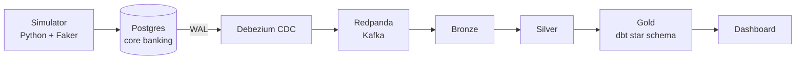

# Banking Transaction Analytics Pipeline

End-to-end data engineering project that captures changes from a core banking
database (Postgres) using CDC, processes them through Bronze/Silver/Gold layers,
detects fraud in near real time, and reconciles the warehouse against the source ledger.

## Architecture

## Progress

- [x] Docker Compose setup
- [x] Postgres schema (customers, accounts, merchants, transactions, ledger_entries)
- [x] Data simulator with messy data (duplicates, late events, invalid values, updates)
- [x] CDC with Debezium and Redpanda (connector running)
- [x] Bronze layer (Python consumer)
- [x] Silver layer (dedup, validation, quarantine, PII masking)
- [x] Fraud detection rules
- [x] Gold layer with dbt (star schema, SCD Type 2, 14 tests)
- [x] Reconciliation job (core vs warehouse, 7 checks)
- [ ] Dashboard

## Tech stack
Postgres, Debezium, Redpanda, Python, dbt, Metabase, Docker Compose